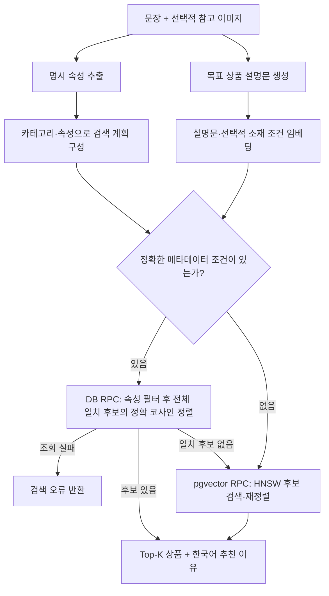

# F1T — Fashion Intention Translator

**문장과 참고 이미지에 담긴 조건을 함께 반영하는 4인 팀 패션 검색 프로젝트**

“출근할 때 입을 단정한 검은 셔츠”처럼 원하는 옷을 설명하거나, 사진에 “비슷하지만 여유 있는 핏으로”라는 조건을 더해 상품을 찾습니다. 상품명뿐 아니라 색상·소재·핏·입을 상황을 검색에 반영하는 것을 목표로 합니다.

[팀 서비스 데모](https://f1t-clean-front.vercel.app/) · [백엔드](backend/README.md) · [검색 파이프라인](pipeline/README.md) · [프론트엔드](frontend/README.md)

## 프로젝트 개요

- **해결하려는 문제:** 원하는 옷의 상품명이나 정확한 검색어를 모를 때, 여러 조건을 조합해 상품을 찾기 어렵습니다.
- **접근 방식:** 문장과 이미지를 검색용 설명으로 정리하고, 명시한 속성으로 후보를 좁힌 뒤 의미·시각적 유사도로 정렬합니다.
- **데이터 범위:** 상의·바지·원피스·스커트 등 패션 상품 19,833개를 대상으로 구축했습니다.
- **팀 구성:** 데이터 수집·구축, 검색 파이프라인, 서비스 구현, 평가 질의 구성을 분담한 4인 팀 프로젝트입니다.

## 담당 역할 — 허원준

팀 리더로서 백엔드와 검색 파이프라인 통합을 맡았습니다. 이 저장소는 [팀 프로젝트 F1T](https://github.com/cs-f1t/f1t)를 기반으로, 담당한 검색 흐름과 기술적 판단을 설명합니다.

| 담당 영역 | 구현 내용과 판단 |
| --- | --- |
| 백엔드·파이프라인 통합 | FastAPI 요청을 속성 추출, 설명문 생성, 후보 조회, 랭킹, 추천 이유 반환으로 연결 |
| 목표 상품 설명문 | 참고 이미지의 특징과 텍스트 조건을 하나의 검색용 설명문으로 구성해 임베딩 검색에 전달 |
| 후보 검색·랭킹 | 메타데이터 조건으로 후보를 좁히고 이미지·소재 벡터 점수를 결합하는 흐름 통합 |
| 병렬 처리 | 독립적인 속성 추출과 설명문 생성의 병렬화 아이디어를 제안하고, 외부 API 응답 대기를 겹치도록 구성 |
| 서비스 연결 | 프론트엔드와 검색 API 연결, Vercel·Cloudtype 배포 구성 |

상품 데이터 수집·DB·임베딩 구축·속성 추출 등 팀원이 담당한 영역은 아래 팀 구성 표에 구분했습니다. 실험 결과는 팀의 공동 산출물입니다.

## 주요 기능

| 사용 예시 | 서비스 동작 |
| --- | --- |
| “검은색 긴팔 셔츠” | 문장에서 색상·소매·종류 등 조건을 추출해 상품 검색에 반영 |
| “주말 나들이에 입을 편한 옷” | 상황과 스타일을 검색용 설명으로 구체화해 관련 상품 탐색 |
| 참고 이미지 + “이런 느낌에 소재는 린넨으로” | 이미지 특징과 변경 요청을 함께 반영한 설명문 생성 |
| 검색 결과 확인 | 상품·가격·해석한 조건·추천 이유 확인 및 원본 상품 페이지 이동 |

## 기존 실험 결과

팀에서 단일 조건부터 복합 조건까지 구성한 텍스트·이미지 포함 질의 102개에 대한 기존 내부 평가 집계입니다.

| 항목 | 결과 |
| --- | ---: |
| 패션 상품 데이터 | 19,833개 |
| 평가 질의 | 102개 |
| Top-1 완전 적합 | 80건 (78.4%) |
| Top-1 부분 적합 포함 | 97건 (95.1%) |
| 평균 검색 후보 | 19,833개 → 2,707개 |
| 후보 축소율 | 86.35% |

첫 번째 검색 결과를 완전 적합 80건, 부분 적합 17건, 실패 5건으로 분류한 집계입니다. 평가는 AI 판정을 활용했습니다. 위 수치는 과거 실험 기록이며, 아래 기술 스택의 현재 기본 모델과 수정된 코드로 재측정한 결과는 아닙니다.

## 검색 구조



참고 이미지를 질의 벡터로 바로 사용하는 대신, 이미지와 문장을 함께 해석해 만든 **목표 상품 설명문(Target Description)**을 검색 입력으로 사용합니다. 이 설명문을 상품 이미지의 저장 벡터와 비교합니다.

### 1. 명시한 조건과 의미 기반 검색의 결합

사용자가 언급한 속성의 종류를 먼저 확인하고 해당 값만 추출해, 말하지 않은 조건이 필터에 추가되는 것을 줄이도록 설계했습니다. 소매·기장·성별·계절·신축성·두께·핏 등 정확한 메타데이터 조건이 있으면 DB 함수가 조건에 맞는 전체 후보의 코사인 유사도를 계산하고 상위 상품만 반환합니다. 후보를 ID순 1,000개로 제한하지 않으며, 상품 벡터도 네트워크로 내려받지 않습니다. 정확 조건이 없거나 일치 후보가 0개이면 기존 HNSW RPC 검색을 사용합니다. 조회 실패는 조건을 완화하지 않고 검색 오류로 반환합니다.

색상과 소재는 모든 경우에 일치가 보장되는 필수 필터가 아닙니다. 검색용 설명과 유사도 계산에 반영하며, 참고 이미지와 문장의 요구가 다르면 명시한 텍스트 조건을 우선하도록 요청합니다.

### 2. 독립적인 모델 호출의 병렬 처리

검색 대기 시간을 줄이기 위해, 같은 원본 입력을 사용하고 서로의 결과를 기다릴 필요가 없는 **메타데이터 추출과 목표 설명문 생성**을 `ThreadPoolExecutor`로 병렬 실행하도록 구성했습니다. 이후 설명문 임베딩·선택적 소재 임베딩도 병렬로 처리합니다.

외부 API 응답 대기를 겹치는 방식이며, 필요한 작업이 끝나면 결과를 반환합니다. 병렬화 전후의 응답 시간 개선율은 별도 측정 전이므로 수치로 제시하지 않습니다.

### 3. 이미지와 소재를 함께 고려하는 정렬

소재 조건이 있으면 `이미지 유사도 × 0.8 + 소재 유사도 × 0.2`, 없으면 이미지 유사도로 정렬합니다. 이 가중치는 현재 구현의 설정이며, 비교 실험으로 최적값이 입증된 것은 아닙니다. 유사도는 내부 순위 계산에 사용하고 고객 화면에는 검색 조건과 추천 이유를 제공합니다.

### 4. 검색 경로와 HNSW 후보 수

| 경로 | 처리 방식 | 설계상 의미 |
| --- | --- | --- |
| 정확 메타데이터 조건이 있는 경우 | `match_fashion_items_filtered_768` RPC에서 필터·정확 코사인 정렬을 수행하고 상위 상품만 전송 | ID순 후보 상한 없이 조건에 맞는 전체 후보에서 순위를 계산 |
| 정확 조건이 없거나 일치 후보가 0개인 경우 | `match_fashion_items_768` RPC에서 이미지 HNSW 후보 검색 후 소재 점수 반영 | 근사 검색으로 후보를 찾고, 조건 완화 여부를 응답에 기록 |

기존 HNSW RPC의 최종 반환 수는 1~100개이며, 재정렬 후보는 `min(max(최종 반환 수 × 5, 50), 100)`개로 설정합니다. 기본 Top-10 요청은 후보 50개를 재정렬합니다. `hnsw.ef_search=100`은 HNSW 내부 탐색 폭으로, 재정렬 후보 수와 구분됩니다. 소재 벡터는 이미지 검색이 고른 후보의 순위를 조정하는 데 사용합니다.

정확 필터 RPC의 `matched_count`는 조건에 맞아 비교한 후보 수이며, 실제 반환 상품 수와 다릅니다. 응답의 `pipeline.retrieval_diagnostics`에는 DB 필터·정렬 시간, HTTP 대기·본문 수신·JSON 파싱 시간과 전송 바이트를 기록합니다. DB 시간은 HTTP 시간에 포함되므로 두 값을 합산하지 않습니다.

구현은 [파이프라인 조율](pipeline/recommendation_service.py), [임베딩 인코딩](pipeline/retrieval/target_description_retrieval.py), [정확 필터 검색 SQL](pipeline/sql/match_fashion_items_filtered_768.sql), [HNSW 검색 SQL](pipeline/sql/match_fashion_items_768.sql)에서 확인할 수 있습니다.

## 팀 구성과 역할

팀은 상품 데이터 수집·구축부터 요청 해석, 후보 검색·랭킹, 웹 서비스 연결까지 협업했습니다. 아래는 주요 담당 영역이며, 전체 기능과 실험 결과는 팀 프로젝트의 산출물입니다.

| 팀원 | 역할 | 주요 담당 영역 |
| --- | --- | --- |
| 허원준 | 팀 리더 | 백엔드·파이프라인 통합, 목표 설명문 생성, 검색·랭킹, 추천 이유, 배포 연결 |
| 김상훈 | 팀원 | 문서, 평가 질의 구성, 상품 데이터 크롤링 |
| 김재혁 | 팀원 | 상품 DB, 메타데이터, 이미지·소재 임베딩 구축 |
| 박주현 | 팀원 | VLM 메타데이터 추출, 후보 필터링 설계, 프로젝트 진행 관리 |

## 기술 스택

아래 모델명은 현재 코드의 기본 설정입니다. 과거 평가에 사용한 모델과 동일하다는 의미는 아닙니다.

| 영역 | 기술 |
| --- | --- |
| Frontend | React 19, TypeScript, Vite, Tailwind CSS |
| Backend | Python, FastAPI, Uvicorn |
| 요청 해석·설명 생성 | Gemini (`gemini-3.5-flash-lite`), Google Gen AI SDK |
| Embedding | Gemini Embedding 2 (`gemini-embedding-2`), 768차원 |
| Retrieval | Supabase PostgreSQL, pgvector, HNSW, 코사인 유사도 |
| Deployment | Vercel, Cloudtype |

## 검증 범위와 한계

- 프론트엔드는 검색·카탈로그의 비동기 상태와 API 실패 처리를 테스트하고, 백엔드·파이프라인은 요청 처리와 검색 분기 등을 테스트합니다.
- 기존 실험 결과는 위 표에 보존했습니다. 현재 버전의 검색 품질 및 병렬화 효과를 비교하려면 데이터·모델·판정 기준을 고정한 재측정이 필요합니다.
- 검색 결과는 수집된 상품 정보를 기준으로 합니다. 현재 가격·재고·판매 여부는 원본 쇼핑몰에서 확인해야 합니다.

## 로컬 실행

외부 모델 API와 상품 데이터가 구축된 Supabase 프로젝트가 필요합니다. 각 모듈의 환경변수와 실행 방법은 아래 문서에서 확인할 수 있습니다.

- [백엔드 실행 및 요청 제한](backend/README.md)
- [검색 파이프라인과 DB 구성](pipeline/README.md)
- [프론트엔드 환경 설정](frontend/README.md)

저장소 루트에서 백엔드 테스트를 실행하고, 프론트엔드 폴더에서 UI 관련 검증을 실행합니다.

```bash
python -m pytest -q
cd frontend
npm ci
npm test
npm run lint
npm run build
```
